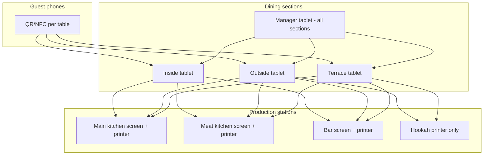

# My Restaurant — Stations, Sections & Hardware

**Demo venue:** My Restaurant  
**Venue capacity:** ~250–300 guests  
**Confirmed layout:** July 2026 · **UI refresh:** August 2026 (metallic black + orange, staff i18n)

Staff apps (`/kitchen`, `/waiter`, `/admin`) support **ar → he → en → ru**. Kitchen KDS supports **tap** and **drag-and-drop** between New / Preparing / Ready.

---

## Production stations (4)

Orders route by **menu item** to one station. Each station has its own printer; screens where noted.

| Station | Screen | Printer | Example items |
|---------|--------|---------|----------------|
| **Main kitchen** | Yes (KDS) | Yes | Salads, starters, fish, chicken, desserts, sides, breakfast |
| **Meat kitchen** | Yes (KDS) | Yes | Kebab, entrecote, fillet, T-bone, meat boutique, grills |
| **Bar** | Yes (KDS) | Yes | Beer, wine, cocktails, arak, soft drinks, coffee |
| **Hookah** | No | **Yes only** | Shisha, refills, coal, hookah-related add-ons |

### Routing rules

```
MenuItem.route = MAIN_KITCHEN | MEAT_KITCHEN | BAR | HOOKAH
```

- One guest order can split across **multiple stations** (e.g. kebab → meat kitchen, mojito → bar, hookah → hookah printer).
- Kitchen tickets show: **section · table number · order # · items · notes**.

### Hookah note

Hookah is served in **Outside** and **Terrace** sections (not a separate dining section). Tables in those sections can order hookah; items still route to **HOOKAH** printer only.

---

## Dining sections (3)

Tables belong to exactly one section. Waiter tablets filter the floor map by section.

| Section | Arabic | Waiter tablet |
|---------|--------|----------------|
| **Inside** | داخل | 1 shared tablet |
| **Outside** | خارج | 1 shared tablet |
| **Terrace** | تراس | 1 shared tablet |
| **Manager** | مدير | 1 tablet — **all sections** |

**Total waiter/manager tablets: 4**

Waiters in the same section **share** one tablet (not one per person).

---

## Floor diagram



---

## Hardware summary (My Restaurant)

| Device | Quantity |
|--------|----------|
| Waiter tablets (inside / outside / terrace) | **3** |
| Manager tablet | **1** |
| Main kitchen KDS + printer | **1 + 1** |
| Meat kitchen KDS + printer | **1 + 1** |
| Bar KDS + printer | **1 + 1** |
| Hookah printer | **1** |
| Edge server | **1** |
| NFC/QR table stands | **~55–75** (per table) |
| Admin PC | **1** |

**Screens: 7** (3 waiter + 1 manager + 3 station KDS)  
**Printers: 4** (main, meat, bar, hookah)

---

## Staff roles (app login)

| Role | Access |
|------|--------|
| `ADMIN` | Full config, menu, all sections |
| `MANAGER` | All sections floor map, reports, override, all alerts |
| `WAITER` | Single section floor map, cash, alerts for that section |
| `KITCHEN` | Station KDS (filter: main or meat or bar) |

---

## API / UI implications

- `GET /api/v1/waiter/tables?section=INSIDE` — section-scoped floor map
- `GET /api/v1/kitchen/orders?station=MEAT_KITCHEN` — station queue
- Order tickets include `table.section` for runners (e.g. "Terrace · T24")
- Manager app: section tabs **داخل | خارج | تراس | الكل**

---

## Printer config (`edge-server/print/config.json`)

```json
{
  "mainKitchen": { "type": "network", "address": "192.168.1.101:9100" },
  "meatKitchen": { "type": "network", "address": "192.168.1.102:9100" },
  "bar": { "type": "network", "address": "192.168.1.103:9100" },
  "hookah": { "type": "network", "address": "192.168.1.104:9100" }
}
```

Hookah station staff work from **printed chits** + waiter alerts (no KDS screen).
